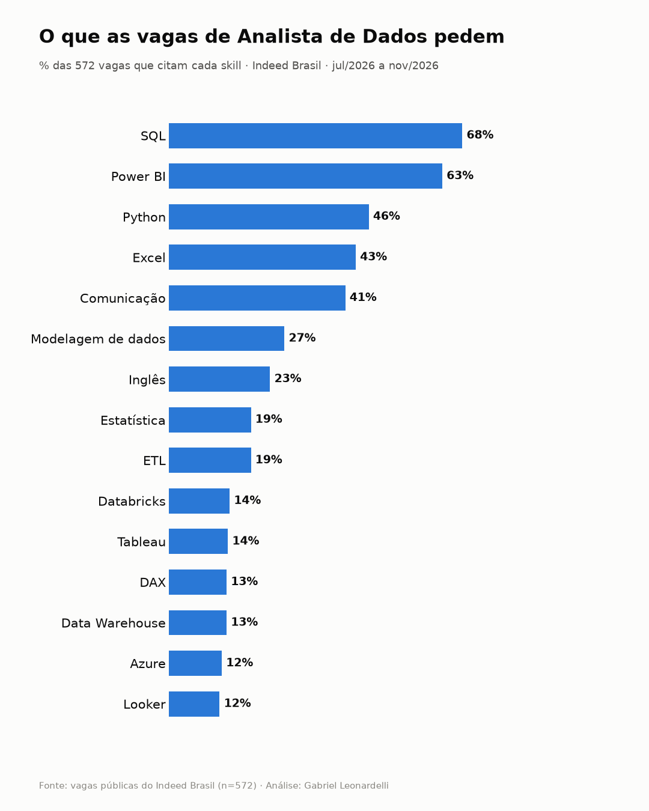
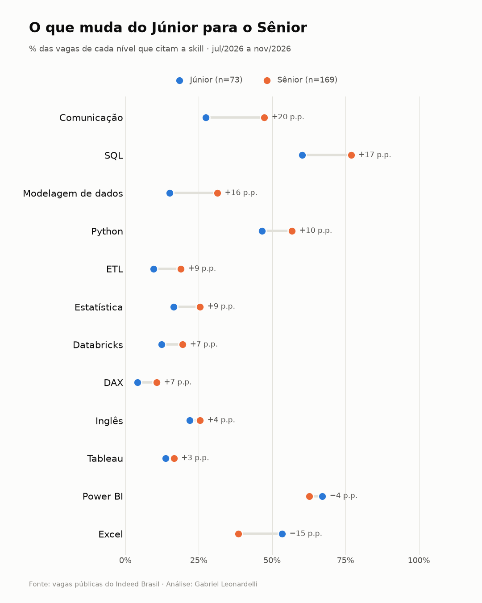

# 📊 Quais skills o mercado pede para Analista de Dados?

Analisei **572 vagas** de Analista de Dados e BI, de **420 empresas**, publicadas no Indeed Brasil entre **24/jul e 21/nov de 2026**, para descobrir quais ferramentas e habilidades aparecem com mais frequência nas descrições.



## 🔑 Principais resultados

- **68%** das vagas pedem **SQL**: é a skill mais pedida.
- **63%** pedem **Power BI**, que é a ferramenta de visualização dominante (Tableau aparece em 14% e Looker em 12%).
- **Python (46%) já aparece em mais vagas que Excel (43%).**
- **41%** citam **comunicação**, a skill comportamental mais citada.
- **68%** das vagas descrevem trabalho com **indicadores / KPIs**. Como o termo quase sempre descreve a tarefa, e não uma ferramenta, ele ficou fora do ranking (veja *Decisões de método*).
- Só **11%** das vagas são marcadas como remotas.

## 🧭 O que muda do Júnior para o Sênior



- **Comunicação** tem o maior salto: de 27% das vagas júnior para 47% das sênior (**+20 p.p.**).
- **SQL** (+17 p.p.) e **Modelagem de dados** (+16 p.p.) também crescem bastante com o nível.
- **Excel** faz o caminho inverso: aparece em 53% das vagas júnior e em 38% das sênior (**−15 p.p.**). Ele pesa mais na porta de entrada.
- **Power BI** fica estável em todos os níveis (63% a 67%), porque é a base do trabalho em qualquer senioridade.

## ⚙️ Como foi feito

| Etapa | O que acontece | Arquivo |
|---|---|---|
| 1. Coleta | Busca no Indeed Brasil com 7 termos ("analista de dados", "data analyst", "analista de BI", "business intelligence" e variações por nível), vagas dos últimos 120 dias | `src/coleta.py` |
| 2. Limpeza | Remove vagas repetidas, mantém só vagas de Analista de Dados/BI pelo título, classifica a senioridade | `src/limpeza.py` |
| 3. Análise | Procura cada uma das 29 skills na descrição com expressões regulares e calcula o % de vagas que a citam | `src/analise.py` |

**Funil da limpeza**

| Etapa | Vagas |
|---|---|
| Vagas coletadas (com repetidas) | 4.782 |
| Sem repetidas | 3.611 |
| Só Analista de Dados / BI | 572 |

A busca do Indeed traz muitas vagas de outras áreas, como "Analista Comercial", "Analista de Logística", "Engenheiro de Dados" e "Cientista de Dados". Por isso o filtro de título é a etapa que mais corta.

**Como o percentual é calculado:** uma vaga conta para a skill se a descrição cita a skill pelo menos uma vez.
`% = vagas que citam a skill ÷ total de vagas analisadas`

### Decisões de método
Antes de fechar o ranking, li amostras das descrições para conferir se cada skill estava sendo contada do jeito certo. Isso levou a dois ajustes:
- **Indicadores / KPIs fora do ranking:** em 68% das vagas a palavra aparece, mas quase sempre como tarefa ("monitorar indicadores de vendas"). O termo "KPI" explícito aparece em só 26%.
- **Estatística sem contar formação acadêmica:** muitas vagas citam estatística só como curso ("ensino superior em engenharia, matemática, estatística ou áreas correlatas"). Essas menções foram descartadas, e o percentual caiu de 42% para 19%.

### Limitações
- Uma única fonte (Indeed Brasil) e um recorte de 4 meses.
- A busca por palavras não entende contexto: "Python é um diferencial" e "Python obrigatório" contam igual.
- A senioridade vem do título da vaga. 192 vagas não informam o nível, e o grupo Júnior tem menos vagas (73) que o Sênior (169).

## ▶️ Como rodar

```bash
git clone https://github.com/GabrielLeo12/skills-analista-dados.git
cd skills-analista-dados
python -m venv .venv
.venv\Scripts\activate           # Mac/Linux: source .venv/bin/activate
pip install -r requirements.txt
python main.py                   # coleta + limpeza + análise
python main.py --pular-coleta    # só limpeza + análise, usando os dados já coletados
```

Para mudar os termos de busca, o período ou a lista de skills, edite `src/config.py`.

## 📁 Arquivos de resultado

| Arquivo | Conteúdo |
|---|---|
| `outputs/graficos/top_skills.png` | Ranking das 15 skills mais pedidas |
| `outputs/graficos/junior_vs_senior.png` | Comparação Júnior × Sênior |
| `outputs/tabelas/ranking_skills.csv` | Todas as skills, com número de vagas e % |
| `outputs/tabelas/skills_por_senioridade.csv` | % de cada skill por nível |
| `outputs/tabelas/base_dashboard.csv` | Uma linha por vaga, com uma coluna Sim/Não por skill (base para Power BI/Excel) |
| `outputs/tabelas/resumo.md` | Resumo dos números |

## 🛠️ Tecnologias
Python · pandas · matplotlib · regex · JobSpy

---
Feito por **Gabriel Leonardelli** · [LinkedIn](https://www.linkedin.com/in/[seu-perfil])
